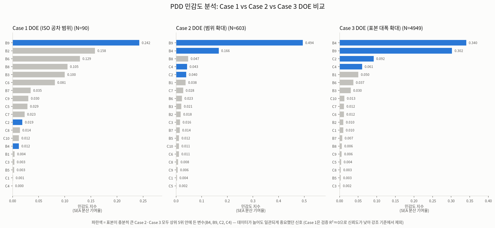
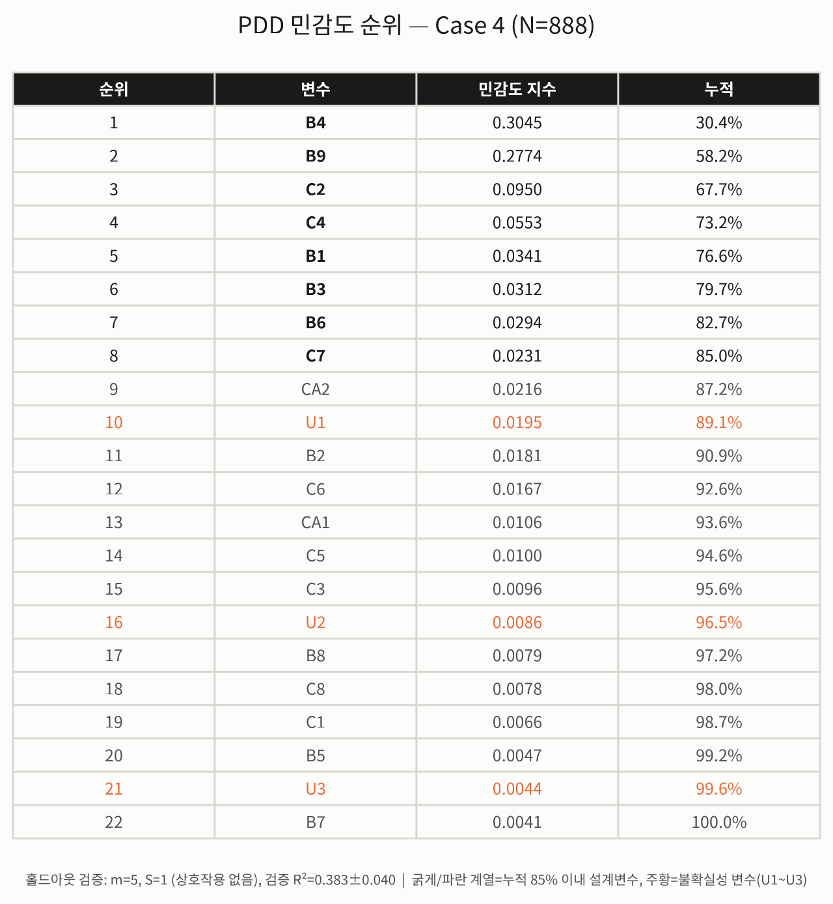
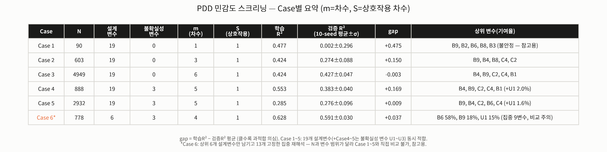

# PDD 기반의 Surrogate Modeling을 이용한 범퍼 강건 설계

**저자**: 한현석, 황태영
**연구 유형**: 종합설계 프로젝트

> 이 문서는 연구가 진행되는 대로 계속 갱신되는 논문/발표자료 초안이다. 실제 작업 순서와 무관하게 논문 서술 순서(서론 → 이론 → 방법 → 결과 → 결론)로 정리해서, 연구가 끝났을 때 이 문서만 보고 PPT나 발표 스크립트를 만들 수 있게 하는 것이 목적이다. 아직 완료되지 않은 항목은 "(작성 예정)"으로 표시한다.

## 초록 (Abstract)

*(작성 예정 — 전체 연구가 마무리되면 결과를 요약해 채울 것)*

본 연구는 차량 범퍼의 충돌 에너지 흡수 성능(SEA, Specific Energy Absorption)을 극대화하면서, 재료 물성 편차·제조 공차·충돌 조건 등의 불확실성 아래에서도 그 성능이 안정적으로 유지되는 강건 설계(robust design)를 목표로 한다. 카티아(CATIA)로 범퍼 3D 형상을 파라메트릭하게 모델링하고, 아바쿠스(Abaqus/Explicit)로 충돌 유한요소(FE) 해석을 수행해 SEA를 산출한다. FE 해석은 계산 비용이 크므로, 소수의 실험계획법(DOE) 표본만으로 전체 설계공간의 응답을 근사하는 서로게이트 모델링을 도입한다. 먼저 다항식 차원분해(PDD, Polynomial Dimensional Decomposition)를 이용해 설계변수별 민감도를 분석하고, 실제 예측 서로게이트는 비선형·비매끄러운 충돌 응답에 더 적합한 크리깅(Kriging) 모델로 구축한다. 이렇게 얻은 서로게이트 위에서 평균-표준편차 기반 강건 목적함수를 구성하고 최적화를 수행한다.

## 목차

1. [서론](#1-서론)
2. [이론적 배경](#2-이론적-배경)
   - 2.1 [PDD와 전역 민감도 분석](#21-pdd와-전역-민감도-분석)
   - 2.2 [크리깅(Gaussian Process) 서로게이트](#22-크리깅gaussian-process-서로게이트)
   - 2.3 [강건 설계 최적화(RDO)](#23-강건-설계-최적화rdo)
3. [연구 방법](#3-연구-방법)
   - 3.1 [범퍼 형상 설계 (CATIA)](#31-범퍼-형상-설계-catia)
   - 3.2 [충돌 FE 해석 (Abaqus)](#32-충돌-fe-해석-abaqus)
   - 3.3 [실험계획법(DOE)](#33-실험계획법doe)
   - 3.4 [PDD 기반 민감도 분석](#34-pdd-기반-민감도-분석)
   - 3.5 [서로게이트 모델 선정: PDD vs 크리깅](#35-서로게이트-모델-선정-pdd-vs-크리깅)
   - 3.6 [강건 목적함수 및 최적화](#36-강건-목적함수-및-최적화)
   - 3.7 [능동학습 및 베이지안 최적화 도입 (AI 요소)](#37-능동학습-및-베이지안-최적화-도입-ai-요소)
4. [결과](#4-결과)
5. [결론](#5-결론)
6. [참고문헌](#6-참고문헌)

## 1. 서론

차량 충돌 시 범퍼는 가장 먼저 에너지를 흡수하는 구조로, 탑승자와 보행자 안전에 직접적인 영향을 준다. 범퍼 설계에서는 흡수 에너지를 질량으로 나눈 비에너지흡수율(SEA)을 높이는 것이 핵심 목표인데, 이는 같은 무게로 더 많은 충돌 에너지를 흡수한다는 의미로 경량화와 안전성을 동시에 만족시키는 지표다. 그러나 실제 양산 환경에서는 재료 물성의 편차, 두께 등 제조 공차, 충돌 속도·각도의 변동성 등 다양한 불확실성이 존재하며, 이러한 불확실성 아래에서도 SEA가 크게 흔들리지 않는 강건한 설계가 요구된다.

이 연구는 이러한 문제를 해결하기 위해 서로게이트 모델링 기반 강건 최적 설계 프레임워크를 구축한다. 범퍼 형상은 카티아로 파라메트릭하게 설계하고, 충돌 해석은 아바쿠스로 수행한다. 유한요소 해석은 계산 비용이 크기 때문에, 소수의 DOE 표본으로 얻은 해석 결과로부터 값싼 서로게이트를 만들고, 그 위에서 민감도 분석과 강건 최적화를 수행하는 전략을 취한다. 서로게이트 구축 단계에서는 다항식 차원분해(PDD)를 이용해 어떤 설계변수가 SEA에 실질적인 영향을 주는지 먼저 screening하고, 실제 예측 모델은 비선형적이고 불연속적인 특성을 가질 수 있는 충돌 응답에 더 적합한 크리깅(Kriging) 서로게이트로 구축한다. 이 조합을 통해 PDD 고유의 해석적 분산 분해 능력과, 크리깅의 국소 적응적 예측 능력을 모두 활용하는 것이 본 연구의 방법론적 특징이다.

## 2. 이론적 배경

### 2.1 PDD와 전역 민감도 분석

다항식 차원분해(Polynomial Dimensional Decomposition, PDD)는 다변수 함수를 분산분석(ANOVA) 방식으로 분해해, 상수항·단독 변수 효과·변수 간 교호작용의 합으로 표현하는 기법이다. 각 성분 함수를 직교 다항식(본 연구에서는 균등분포 입력에 적합한 르장드르 다항식)으로 전개하고, 실제 해석 결과에 최소자승 회귀를 적용해 계수를 추정한다. 상호작용을 포함하는 변수 개수(S)와 다항식 차수(m)를 제한해 절단하면, 변수 개수가 많아져도 필요한 항의 개수가 조합적으로 폭발하지 않는다는 장점이 있다. 얻어진 계수로부터 각 변수·변수 조합이 전체 분산에 기여하는 비율(Sobol 민감도 지수)을 계산할 수 있어, 설계변수 스크리닝(변수 축소)에 효과적으로 활용된다.

입력변수 `dim`개(x₁, ..., x_dim)에 대해 차수 `m`, 상호작용 변수 개수 `S`까지 절단한 PDD 근사식은 다음과 같다.

```
f(x) ≈ c₀
      + Σᵢ₌₁^dim Σⱼ₌₁ᵐ cᵢⱼ · Pⱼ(xᵢ)                                     [단독 변수 항]
      + Σ_{k<l} Σᵢ₌₂ᵐ Σⱼ₌₁ⁱ⁻¹ cₖₗ,ⱼ,ᵢ₋ⱼ · Pⱼ(xₖ) · Pᵢ₋ⱼ(xₗ)               [2변수 상호작용 항, S=2일 때만]
```

여기서 `Pⱼ`는 j차 르장드르(Legendre) 다항식으로, 다음 점화식으로 계산한다.

```
P₀(x) = 1,   P₁(x) = x
P_{m+1}(x) = [(2m+1)·x·Pₘ(x) − m·Pₘ₋₁(x)] / (m+1)
```

계수 `c`는 각 항을 평가한 값들로 이루어진 설계행렬 `Φ`(표본 수 × 항 개수)에 대해 최소자승으로 추정한다.

```
C = Φ⁺ Y     (Φ⁺: Φ의 무어-펜로즈 유사역행렬, 수치적으로 pinv(Φ)Y로 계산)
```

변수(조합) `S`의 민감도(Sobol) 지수는, `S`에서만 나온 항들이 만드는 예측값의 경험적 분산을 전체 분산으로 나눈 비율로 정의한다.

```
D_S = Σ_{i: 항 i가 변수집합 S에서만 옴} Var[ Cᵢ · Φᵢ ]
S_S = D_S / Σ_{S'} D_{S'}                (0~1, 전체 합=1)
```

사용한 르장드르 기저가 표본 분포 하에서 완전한 정규직교가 아니므로, 이상적인 Sobol 분해처럼 계수 제곱합만으로 계산하지 않고 항별 예측값의 경험적 분산으로 근사한다.

차수 `m`과 상호작용 차수 `S`는 홀드아웃 검증 R²를 기준으로 자동 선택한다. 학습 데이터만으로 선택하면 차수를 올릴수록 항상 좋아 보여 과적합되므로, 반드시 검증셋 기준으로 판단한다.

```
(m*, S*) = argmax_{(m,S)} R²_valid(m, S)
```

### 2.2 크리깅(Gaussian Process) 서로게이트

크리깅은 관측된 표본들 사이의 상관구조(커널 함수)를 이용해 미관측 지점의 응답을 확률적으로 보간하는 비모수적 회귀 기법이다. PDD와 같은 전역 다항식 기반 서로게이트와 달리, 크리깅은 국소적으로 적응하는 예측을 하기 때문에 응답면이 비선형적이거나 매끄럽지 않은(non-smooth) 경우에도 상대적으로 강건한 예측 성능을 보인다. 범퍼와 같은 박판 구조물의 충돌 흡수 거동은 좌굴 모드 전환 등으로 설계변수에 대해 꺾인(kinked) 형태의 응답을 보일 수 있어, 이런 특성을 다루는 데 크리깅이 적합하다고 판단했다(3.5절 참고).

크리깅은 관측값이 평균 0(또는 상수 트렌드)인 가우시안 프로세스(GP)에서 나왔다고 가정한다. 두 입력 `x`, `x'` 사이의 공분산은 커널 함수 `k(x,x')`로 정의하며, 본 연구에서는 Matérn 커널(ν=5/2)에 화이트 노이즈 항을 더해 사용한다.

```
k(x, x') = σ_f² · (1 + √5·r/ℓ + 5r²/(3ℓ²)) · exp(−√5·r/ℓ) + σ_n²·δ(x, x'),   r = ‖x − x'‖
```

`ℓ`(length scale)은 등방성(isotropic) 커널에서는 스칼라 하나지만, 변수별 민감도 차이가 큰 경우(3.5절 참고) 변수마다 다른 `ℓᵢ`를 쓰는 비등방성(ARD, Automatic Relevance Determination) 커널로 확장할 수 있다. 표본 `N`개의 학습 데이터 `(X, y)`가 주어졌을 때, 새 입력 `x*`에서의 예측 평균·분산은 다음과 같다.

```
μ*(x*) = k*ᵀ (K + σ_n² I)⁻¹ y
σ*²(x*) = k(x*, x*) − k*ᵀ (K + σ_n² I)⁻¹ k*
```

여기서 `K`는 학습 데이터 간 공분산 행렬(N×N), `k*`는 `x*`와 학습 데이터 사이의 공분산 벡터(N×1)이다. 하이퍼파라미터(σ_f, ℓ, σ_n)는 로그 한계우도(log marginal likelihood)를 최대화해 추정한다.

```
log p(y | X) = −½ yᵀ(K+σ_n²I)⁻¹y − ½ log|K+σ_n²I| − (N/2) log(2π)
```

### 2.3 강건 설계 최적화(RDO)

강건 설계 최적화는 목적함수의 평균 성능과 그 변동성(표준편차)을 동시에 고려하는 최적화 기법이다. 본 연구에서는 서로게이트로 근사한 SEA에 대해 다음과 같은 목적함수를 사용한다.

```
maximize   J(x) = mean(SEA) − κ · std(SEA)
```

여기서 `x`는 설계변수, `κ`는 강건성에 대한 가중치이다. 설계변수는 카티아에서 직접 조절하는 변수(design variable, 이하 `x_d`)와, 재료 물성·충돌 조건처럼 불확실성을 갖는 변수(uncertain/random variable, 이하 `x_n`)로 구분한다.

mean(SEA)·std(SEA)는 `x_d`를 고정한 채 `x_n`만 그 범위 안에서 `M`개 몬테카를로 표본으로 흔들어, 학습된 서로게이트 `Ĝ`(크리깅 예측 함수)로 재평가해 추정한다. FE를 다시 돌리는 게 아니라 이미 적합된 서로게이트만 재평가하는 것이라 비용이 거의 들지 않는다.

```
mean(SEA; x_d) ≈ (1/M) Σ_{m=1}^{M} Ĝ(x_d, x_n^(m))
std(SEA; x_d)  ≈ √[ (1/(M−1)) Σ_{m=1}^{M} (Ĝ(x_d, x_n^(m)) − mean(SEA; x_d))² ],   x_n^(m) ~ U(불확실성 변수 범위)
```

최적화 문제는 `x_d`에 대해 `J(x_d)`를 최대화하는 것으로, 박스 제약(설계변수 범위)과 필요시 질량·PCF 등 추가 제약을 둔다.

```
x_d* = argmax_{x_d}  J(x_d) = mean(SEA; x_d) − κ · std(SEA; x_d)
        subject to   x_d ∈ [설계변수 하한, 상한],  (필요시) 질량 ≤ 상한 등
```

이 문제는 그래디언트 기반의 국소 제약조건부 최적화 기법인 SLSQP(Sequential Least Squares Quadratic Programming)로 푼다(3.6절 참고).

## 3. 연구 방법

### 3.1 범퍼 형상 설계 (CATIA)

*(세부 파라미터 정의·매크로 구성은 추가 예정)*

범퍼 빔·크래시박스의 기본 3D 형상은 CATIA로 설계했다. 베이스 형상은 경량 전기차용 프런트 임팩트 빔의 단면 형상별 크래시워시니스를 비교·최적화한 선행 연구[^3]의 설계를 채택해 구성했다.

### 3.2 충돌 FE 해석 (Abaqus)

*(내용 추가 예정)*

충돌 해석은 Abaqus/Explicit으로 수행한다. 설계변수는 카티아가 아니라 아바쿠스 안에서 직접 파라미터로 정의하고, 각 파라미터의 min/max 범위를 지정해 그 안에서 DOE 점을 뽑아 형상 생성·메싱(솔리드 요소)·해석까지 자동화돼 있다. 이 방식으로 Case 1–7 DOE(100/603/4949/888/2932/778/1482 trial)를 문제없이 뽑아 SEA·질량·에너지 등을 CSV로 추출했다. 정확한 파라미터 정의 방식, 아바쿠스 버전, 재질모델·요소 타입 등 세부 사항은 추후 보강한다.

SEA는 흡수에너지를 질량으로 나눈 값으로 정의한다. Abaqus의 에너지 밸런스에서 내부에너지(`ALLIE`)는 탄성 변형에너지(`ALLSE`)와 소성 변형에너지(`ALLPD`)에, reduced-integration 요소의 아워글래싱(hourglassing)을 억제하기 위해 수치적으로 추가되는 인공변형에너지(`ALLAE`)를 더한 값이다. 초기에는 `ALLIE` 전체를 흡수에너지로 사용했으나, `ALLAE`는 물리적 변형과 무관한 수치 항이므로 이를 제외한 탄성·소성 변형에너지만을 흡수에너지로 재정의했다. 이 보정 전후로 같은 설계점의 SEA는 평균 23% 가량 줄었고, 상대적 순위 역시 Pearson 상관계수 0.67, Spearman 상관계수 0.42 수준으로만 유지되어 단순한 스케일 변화가 아니라 민감도 구조 자체가 바뀌었다(3.4절 참고). 이후 모든 분석은 보정된 SEA를 기준으로 수행한다. 다만 보정 전 데이터에서 역산한 `ALLAE`/`ALLIE` 비율은 21–28% 수준으로, 크래시워시니스 해석에서 통상 인용되는 권장 상한(5–10%)보다 높아 메시 또는 요소 formulation(hourglass control)에 대한 추가 점검이 필요한 한계로 남겨둔다.

### 3.3 실험계획법(DOE)

DOE는 Latin Hypercube Sampling으로 설계공간을 샘플링한다. 설계변수와 불확실성 변수는 함께 흔들되, 두 그룹의 변동폭은 근본적으로 다르게 설정한다. 설계변수는 공칭값 대비 비교적 넓은 범위(초기 계획 기준 ±15%, beam_height만 카티아 형상 업데이트 실패 확인 후 -10%/+15%로 비대칭 조정)로, 불확실성 변수는 그보다 훨씬 좁은 범위(항복강도 ±10%대·두께 공차 ±0.1mm 수준)로 잡는다. 이 구분은 강건 설계 최적화(Robust Parameter Design) 이론에서 "제어(설계)변수는 최적점을 찾기 위해 능동적으로 넓게 탐색해야 하는 변수, 그 바깥의 변수는 실사용 환경에서 통제 불가능한 작은 규모의 불확실성(제조 공차 등)을 나타내는 변수"로 원천적으로 다르게 다루는 것과 같은 논리다[^1]. 크래시워시니스 박판 구조물의 두께 sizing 최적화 문헌에서도 설계변수 탐색 범위를 제조 공차보다 훨씬 넓게, 공칭값 대비 대략 10–30% 이상으로 잡는 것이 일반적이다[^2]. 본 논문에서는 이런 변수를 "불확실성 변수"(uncertain/random variable)라고 부른다. "noise"는 센서 잡음처럼 불가피하게 섞여 드는 것을 가리키는 말과 혼동될 수 있기 때문이다.

DOE는 Case 1–5에 걸쳐 반복적으로 개선되었다. 설계변수와 불확실성 변수의 범위를 위와 같이 명확히 구분하는 작업이 협업 과정에서 항상 매끄럽게 전달되지는 않았는데, 그 경과 자체를 하나의 방법론적 교훈으로 기록해 둔다.

Case 1(100 trial)은 팀원이 Abaqus 쪽에서 독자적으로 생성한 데이터로, 설계변수 19개(B1–B9, C1–C10)가 모두 공칭값 대비 ±1.7–3.3%라는 좁은 범위로만 흔들려 있었다. 사후 확인 결과 이 범위는 ISO 공차 기준으로 의도된 것이었으나, 본래 설계변수에 배정했어야 할 넓은 탐색 범위가 아니라 불확실성 변수 수준의 변동폭이었다. 즉 이 100 trial은 하나의 공칭 형상 주변을 제조공차 수준으로만 흔든 공차 변동 스터디에 해당했고, 설계공간 탐색용 DOE로는 쓸 수 없었다(원인 진단은 3.4절 참고). 이 문제를 확인한 뒤 Case 2(603 trial)에서는 설계변수 범위를 공칭값 대비 약 13%까지 확대하고, 명시적(explicit) 해석의 time step을 줄여 수치적 노이즈도 함께 낮춘 데이터로 재요청했다. Case 3(4949 trial)에서는 표본 수를 대폭 늘려 받았다. 설계변수 범위는 약 6.6%로 Case 2보다 오히려 좁아졌으나, 표본 수 증가의 효과가 범위 축소를 상쇄하고도 남아 3.4절에서 서술하듯 가장 신뢰할 수 있는 민감도 분석 결과를 얻었다.

Case 3 데이터를 이용해 "범위 확대"와 "표본 수 증가" 중 어느 쪽이 민감도 분석 신뢰도 개선에 더 지배적인 요인인지 서브샘플링 실험으로 분리해 확인했다. Case 2(넓은 범위) 데이터에서 표본만 90개로 줄이면 검증 R²가 오히려 음수(-0.160)로 나빠지고, 표본이 250개를 넘어야 개선이 나타나기 시작했다. 이는 범위 확대가 "설계 신호가 데이터에 존재하는지"를 결정하는 전제조건이지만, 그 신호를 과적합 없이 추출하려면 결국 충분한 표본 수가 필요하다는 것을 시사한다. 범위는 좁아졌음에도 표본 증가만으로 더 좋은 결과를 얻은 Case 3의 결과는 이 결론과 일치한다.

Case 1–3 DOE는 전부 설계변수만 흔든 데이터였기 때문에 강건 목적함수(mean−κ·std)를 계산할 불확실성 변수가 없었다. 원래 계획은 불확실성 변수를 항복강도 편차·두께 공차 2개로 잡고, 둘 다 형상은 그대로 둔 채 아바쿠스 입력단(재질 카드·쉘 section thickness)에서만 반영하는 것이었다. 그러나 이는 FE 모델이 쉘 요소라는 전제 하에서만 성립하는 방식이었다. 실제로는 카티아 솔리드 형상을 그대로 임포트해 솔리드(continuum) 요소로 메싱하고 있었고, 솔리드 메싱에서는 두께가 요소의 별도 속성이 아니라 3D 형상 자체에 내재된 값이라 두께 공차를 형상 변경·재메싱 없이 반영할 방법이 없었다. 이에 따라 Case 4 DOE에서는 두께 공차 대신 형상과 무관하게 반영 가능한 후보(항복강도 편차, 충돌 초기 속도, 탄성계수, 마찰계수) 중 하나를 우선 적용하기로 했다. Case 4(888 trial)에서 전달받은 데이터는 불확실성 변수 U1, U2, U3 3개를 포함한 22변수(설계 19 + 불확실성 3) 체계였다. 그 물리적 정체는 이후 팀원 미팅 자료로 사후 확인한 결과, 애초 제안한 4개 후보 중 하나가 아니라 소성 응력-변형률 곡선 파라미터 3개(U1=초기 항복응력, U2=가공경화계수, U3=가공경화지수)를 통째로 채택한 것이었다 — 전부 재질 카드 값이라 형상·메시와 무관하다는 원래 원칙과는 부합한다. Case 5(2932 trial)는 변수 구성·범위를 Case 4와 동일하게 유지한 채 표본 수만 대폭 늘려 받은 데이터다.

현재 미해결 사항으로, C9·C10(Case 4부터 CA1·CA2로 명칭 변경, 값 스케일은 동일)은 Case 1–5 내내 다른 변수와 달리 계속 약 1% 수준의 좁은 변동폭에 머물러 있어 이 두 변수만 생성 방식이 다른 구조적 원인이 있을 가능성이 있다. Case 3에서 설계변수 범위가 Case 2보다 다시 좁아진 이유도 아직 확인되지 않았다.

민감도 분석(3.4절)에서 상위로 확인된 변수를 중심으로 두 차례 집중 재해석을 추가로 수행했다. Case 6(778 trial)은 보정 전 SEA 기준 상위 변수(B1, B4, B6, B9, C2, C4)와 불확실성 변수(U1–U3) 9개만 흔들고 나머지 13개 설계변수는 기존 설계값으로 고정했다. 3.2절에서 서술한 SEA 산출 방식 보정 이후에는 민감도 상위 변수 자체가 바뀌어(3.4절 참고), Case 7(1482 trial)은 보정된 SEA 기준으로 다시 선정한 상위 변수(B2, B3, B5, B6, B8, B9, C3, C5, C7)와 불확실성 변수(U1–U3) 12개로 같은 방식의 집중 재해석을 수행했다.

### 3.4 PDD 기반 민감도 분석

PDD 구현체의 정확성은 실제 데이터 적용에 앞서, 이론적으로 민감도 지수가 알려진 Ishigami 벤치마크 함수로 검증했다. 검증셋 기반으로 다항식 차수를 선택하도록 구성해, 학습 데이터만으로 차수를 선택할 때 발생하는 과적합 문제를 방지했다.

3.3절의 Case 1–5 DOE 데이터에 각각 PDD를 적합해 비교했다. Case 4·5부터는 설계변수 19개에 불확실성 변수(U1–U3) 3개가 더해져 22변수 체계다. 파라미터 수(k) 대비 표본 수(N)의 비율이 결과 신뢰도에 미치는 영향이 표 1에 뚜렷하게 드러난다.

**표 1.** Case 1–5 PDD 민감도 스크리닝 비교(선택 차수, 파라미터 대비 표본 비율, 검증 R²)

| | Case 1 (N=90) | Case 2 (N=603) | Case 3 (N=4949) | Case 4 (N=888) | Case 5 (N=2932) |
|---|---|---|---|---|---|
| 선택된 차수(m, S) | m=1, S=1 | m=3, S=1 | m=6, S=1 | m=5, S=1 | m=5, S=1 |
| 파라미터 수 k (k/N) | 20 (0.222) | 58 (0.096) | 115 (0.023) | 111 (0.125) | 111 (0.038) |
| 전체 학습 R² | 0.478 | 0.424 | 0.424 | 0.553 | 0.285 |
| 10-seed 검증 R² 평균 (표준편차) | 0.002 (0.296) | 0.274 (0.088) | 0.427 (0.047) | 0.383 (0.040) | 0.276 (0.096) |
| 학습R² − 검증R² 격차(gap) | 0.475 | 0.150 | -0.003 | 0.169 | 0.009 |

Case 1은 파라미터 대비 표본이 부족해(k/N=0.222) 학습 R²는 높아 보여도 검증 분할을 바꾸면 R²가 -0.50에서 +0.36까지 흔들려 신뢰할 수 없었다. Case 2는 표본이 늘고 설계변수 범위가 넓어지며 k/N이 0.096으로 낮아져 학습-검증 격차가 크게 줄었다(0.475 → 0.150). Case 3은 표본이 다시 8배 가까이 늘며 k/N이 0.023까지 낮아져, 학습R²-검증R² 격차가 사실상 0(-0.003)이고 10개 시드 전부 0.31–0.49 사이로 좁게 모이는 결과를 얻었다(m=6은 탐색 상한에 우연히 걸린 값이 아니라, patience 제약을 풀고 m=12까지 확인해도 R²가 0.40–0.41 선에서 정체하는 것을 확인해 실제 최적점임을 검증했다). Case 4는 불확실성 변수 3개가 더해지며 변수 수가 19→22로 늘고 표본은 Case 3보다 작아(N=888) k/N이 다시 악화되며(0.023→0.125) 검증 R²가 0.427에서 0.383으로 소폭 하락했다 — k/N 논리와 일치하는 변화다. 그런데 Case 5는 k/N이 0.038로 Case 4보다 훨씬 개선됐음에도 gap은 역대 최저(0.009)로 떨어진 반면 검증 R²는 오히려 더 낮아졌다(0.383→0.276). gap(과적합 정도)은 k/N 논리로 깔끔히 설명되지만, R² 절대 수준의 하락은 k/N만으로 완전히 설명되지 않는 미확정 가설로 남겨둔다(불확실성 변수가 가져온 SEA 변동 성분 일부를 지금 쓰는 무상호작용·저차 PDD 구조가 포착하지 못했을 가능성 — 19변수만으로 Case 5를 재분석하면 검증 가능한 후속 과제다).

민감도 지수(SEA 분산 기여율) 기준 상위 변수는 표본이 충분한 Case 3·4·5에서 뚜렷하게 수렴했다. 상위 4개 변수(B9, B4, C2, C4)가 세 데이터셋 모두에서 공통으로 재현됐고, 그중 B9·B4는 세 데이터셋 모두 1·2위를 다퉜다(Case 5 기준 B9 34%, B4 26%). Case 1·2는 검증 R²가 낮거나 불안정해 이 비교에서는 참고만 하되 제외했다. 세 번 독립적으로(서로 다른 표본·범위에서) 같은 상위 변수가 재현된 것은 `DESIGN_IDX` 후보로서 상당히 신뢰할 만한 근거다.



**그림 1.** Case 1–3 PDD 민감도 지수(SEA 분산 기여율) 비교



**그림 2.** Case 4 PDD 민감도 순위표(전체 22변수)

Case 1–5 데이터 전부에서 일관되게 S=1(상호작용 없음)이 S=2(2변수 상호작용 포함)보다 검증 R²가 높았다. 이것이 "파라미터가 너무 많아서"인지 "데이터 자체에 상호작용 신호가 약해서"인지 분리하기 위해, Case 4 데이터(N=888)에서 전체 22변수와, 민감도 분석 상위 변수만 추린 11변수(B4·B9·C2·C4·B1·B3·B6·C7 설계 8개 + U1·U2·U3 불확실성 변수 3개) 양쪽에서 S=1·S=2를 비교했다.

**표 2.** 상호작용 포함 여부(S=1 vs S=2)에 따른 검증 R² 비교(Case 4, 축소 11변수 기준)

| 차수 m | S=1 (상호작용 없음) | S=2 (상호작용 포함) |
|---|---|---|
| 1 | 0.207 | 0.207 |
| 2 | 0.268 | 0.190 |
| 3 | 0.347 | 0.057 |
| 4 | 0.374 | −0.231 |

(11변수 기준; 전체 22변수에서도 m=2에서 S=1 0.251 vs S=2 −0.199로 같은 패턴.) 파라미터 수를 11개로 크게 줄여도 상호작용을 켜는 순간 차수와 무관하게 검증 R²가 항상 더 나빠졌다 — 표본 부족 문제가 아니라, 지금 데이터 규모에서는 상호작용 항이 실제 신호보다 노이즈를 더 많이 주워담는다는 뜻으로 해석한다. 이에 따라 PDD는 상호작용 없이 변수 스크리닝까지만 담당하고, 상호작용 유무 확인은 3.5절의 크리깅 서로게이트에서 사후적으로 다루기로 했다.

추가 검증으로, 상위 6개 설계변수(B1·B4·B6·B9·C2·C4)와 불확실성 변수(U1–U3) 총 9변수만 남기고 나머지 13개 설계변수를 기존 설계값으로 고정한 집중 재해석(778 trial)을 수행했다. 상호작용을 포함한(m=3, S=2) 자체 분석에서 B6가 58.3%로 압도적 1위를 차지했는데, 이는 Case 3–5의 19변수 풀 스크리닝에서 B6가 4–5위(3.7–4.7%)에 그쳤던 것과 크게 달라 독립적으로 재검증했다. 10-seed 홀드아웃 반복검증 결과 상호작용 없이도(S=1, m=4) B6 58.3% 1위가 그대로 재현되었고 검증 R²=0.591±0.030, gap=0.037로 과적합 신호는 없었다 — 진짜 신호로 판단한다. 다만 19변수 풀 스크리닝 대비 B6 비중이 10배 이상 뛴 것은 변수 수 축소에 따른 단순 재정규화만으로는 설명되지 않으며(재정규화만 가정하면 5–6% 수준이 나와야 함), 나머지 13개 변수를 기존 설계값(기존 DOE와 동일한 공칭 기준점)으로 고정했다는 점도 확인했으나 원인 설명에는 도움이 되지 않았다 — 기준점이 특이해서가 아니라면 B6가 다른 (지금 고정된) 설계변수와 상호작용해야만 드러나는 효과이거나, 전역 저차 PDD가 B6의 비선형 주효과 자체를 구조적으로 놓치고 있었을 가능성이 남는다. 이 결과는 `DESIGN_IDX` 후보에 B6를 포함할지 재검토가 필요함을 시사하며, 최종 판단은 미뤄둔다.



**그림 3.** Case 1–6 PDD 민감도 스크리닝 종합 요약(선택 차수, 검증 R², 상위 변수)

SEA 산출 방식을 보정한(3.2절 참고) 뒤에는 민감도 구조도 함께 바뀌었다. 보정된 SEA로 Case 5와 동일한 설계점을 재계산해 PDD를 다시 적합한 결과, 상위 변수가 B9, B2, U1, C7, B8, B5로 바뀌었다 — 보정 전 상위였던 B4, C2, C4는 밀려났고, 불확실성 변수 U1의 기여율은 1.6%에서 12.8%로 뛰었다. 이어서 수행한 Case 7(보정 SEA 기준 집중 재해석, N=1482, 12변수)에서는 m=5, S=1(상호작용 없음)이 선택되었고, 10-seed 검증 R²=0.366(±0.039), 학습-검증 격차는 0.047로 과적합 없이 안정적이었다. 상위 변수는 B2(32.0%), B9(19.4%), C5(16.5%), U1(10.3%), B5(7.4%), C7(5.1%) 순으로, 불확실성 변수 U1의 비중이 보정 전 Case 4–5의 1–2%대에서 10%대로 뚜렷이 높아졌다. 소성 응력-변형률 곡선의 초기 항복응력(U1)이 탄성-소성 에너지 분배에 직접 관여하는 변수라는 점을 고려하면, 인공변형에너지를 제외해 순수 흡수에너지만 남긴 보정이 U1의 영향을 더 뚜렷하게 드러낸 것으로 해석할 수 있다. 한편 Case 6에서 58.3%로 두드러졌던 B6는 Case 7에서 0.8%로 다시 낮아졌는데, 이것이 SEA 정의 보정에 따른 변화인지 두 Case가 서로 다른 변수를 고정한 데서 온 차이인지는 분리하지 못해 미해결로 남긴다.

`DESIGN_IDX`/`NOISE_IDX`의 최종 확정은 위 미해결 사항들과 3.5절의 크리깅 서로게이트 정확도를 교차 확인한 뒤 진행할 예정이다.

### 3.5 서로게이트 모델 선정: PDD vs 크리깅

범퍼 충돌 응답은 좌굴 모드 전환 등으로 인해 설계변수에 대해 비선형적이고 매끄럽지 않게 변할 수 있어, 전역 다항식 기반의 PDD보다 국소 적응형인 크리깅이 최종 예측 서로게이트로 더 적합할 것으로 판단했다. 이를 실증하기 위해, 두 변수 간 상호작용을 포함하면서 인위적으로 꺾임(kink)을 갖는 합성 벤치마크 함수를 구성하고, 동일한 학습 표본(150개)으로 PDD와 크리깅을 각각 적합한 뒤 독립된 검증 표본(1,000개)으로 예측 정확도를 비교했다. 이 비교는 합성 벤치마크 기준이며, 변수 간 상호작용이 없거나 크리깅 커널을 부적절하게 고정할 경우 반대의 결과가 나올 수 있음을 별도로 확인했다.

**표 3.** PDD vs 크리깅 합성 벤치마크 예측 정확도 비교

| 모델 | R² | RMSE |
|---|---|---|
| PDD | 0.930 | 0.208 |
| 크리깅 | 0.965 | 0.147 |

비교 결과 크리깅이 더 높은 정확도를 보였으며, 특히 응답이 급격히 꺾이는 지점 부근에서 PDD는 곡선을 뭉툭하게 뭉개는 반면 크리깅은 실제 꺾임을 더 근접하게 추적했다. 이 결과를 바탕으로 본 연구에서는 PDD는 변수 민감도 분석(스크리닝) 용도로, 실제 예측 서로게이트는 크리깅으로 역할을 분담했다.

실제 데이터로도 검증을 수행했다. Case 2 DOE 데이터(N=603)에 등방성 Matern 커널(nu=2.5, 전 변수 공통 단일 length_scale) 크리깅을 19개 변수 전체에 대해 학습한 결과, 5-fold 교차검증 R²는 10-seed 평균 0.170(±0.012)으로 같은 데이터에서 PDD가 얻은 검증 R²(0.274)보다 오히려 낮았다. 원인으로는 3.4절에서 확인했듯 SEA 분산의 약 절반이 변수 하나(B9)에 집중된 반면, 등방성 커널은 모든 변수에 동일한 length_scale을 가정해 이런 편중된 민감도 구조를 표현하지 못하기 때문으로 추정했다.

이 가설을 Case 7 데이터(N=1482, 12변수: 설계변수 9개와 불확실성 변수 3개)로 검증했다. 등방성 Matern 커널과, 변수별로 서로 다른 length scale을 학습하는 비등방성(ARD) Matern 커널을 각각 적합해 5-fold 교차검증 R²(10-seed 평균)를 비교한 결과, 등방성 커널은 0.280(±0.027), ARD 커널은 0.368(±0.009)로 ARD가 더 높고 더 안정적인 예측 성능을 보였다.

**표 4.** 등방성 vs ARD 커널 크리깅 교차검증 R² 비교(Case 7, N=1482)

| 커널 | 10-seed 평균 CV R² |
|---|---|
| 등방성(isotropic) | 0.280 (±0.027) |
| 비등방성(ARD) | 0.368 (±0.009) |

학습된 ARD 커널의 변수별 length scale을 보면, B6와 U2의 length scale이 다른 변수보다 수십–수백 배 커 두 변수의 영향이 거의 없는 것으로 학습되었는데, 이는 같은 데이터에 대한 3.4절 PDD 민감도 분석에서 두 변수의 기여율이 각각 0.8%, 0.3%로 가장 낮게 나온 것과 일치한다. 전역 다항식 분해(PDD)와 국소 커널 보간(크리깅)이라는 서로 다른 수학적 가정을 쓰는 두 방법론이 같은 변수 중요도 구조로 수렴한 것은 3.4절 스크리닝 결과의 신뢰성을 뒷받침한다. 이후 서로게이트는 ARD 커널 크리깅을 최종 모델로 사용한다.

### 3.6 강건 목적함수 및 최적화

목적함수·몬테카를로 추정식·최적화 정식화는 2.3절에 정리했다. Case 1–3 DOE는 설계변수만 흔든 데이터라 불확실성 변수(`x_n`)가 없어 실행할 수 없었으나, Case 4 DOE부터 불확실성 변수(U1–U3, 소성 응력-변형률 곡선 파라미터)가 확보되어 std(SEA) 계산 및 RDO 실행 조건은 충족됐다.

질량(`Total_Mass`)은 Case 1 DOE부터 매 trial마다 이미 로깅되고 있으나, 이번 최적화에는 질량 상한을 아직 합의하지 못해 제약으로 포함하지 않았다. 최적점의 예측 질량은 참고용으로만 함께 산출한다.

3.4절의 PDD 스크리닝과 3.5절의 크리깅 검증 결과를 종합해, Case 7의 변수 집합(설계변수 B2, B3, B5, B6, B8, B9, C3, C5, C7을 `x_d`로, 불확실성 변수 U1–U3을 `x_n`으로)과 ARD 커널 크리깅을 최종 서로게이트로 하여 강건 목적함수 최적화를 수행했다. `x_n`에 대한 몬테카를로 표본은 DOE가 Latin Hypercube Sampling으로 균등하게 구성된 점을 반영해 균등분포에서 추출했다. κ를 0–3 범위로 스윕하며 `x_d`에 대해 `J(x_d)`를 SLSQP로 최적화했으며, 지역해를 피하기 위해 매 κ마다 8회 무작위 재시작을 두었다.

**표 5.** κ 스윕에 따른 강건 최적화 결과

| κ | mean(SEA) | std(SEA) | J |
|---|---|---|---|
| 0.0 | 73898.9 | 340.8 | 73898.9 |
| 1.0 | 73843.4 | 317.3 | 73526.0 |
| 2.0 | 73839.4 | 314.7 | 73210.0 |
| 3.0 | 73779.8 | 294.0 | 72897.8 |

기준 설계(전체 변수 공칭 중앙값)의 mean(SEA)=70798.2 대비, κ=0(평균만 최대화)에서 mean(SEA)는 73898.9로 4.4% 개선됐다. κ를 0에서 3까지 올려도 mean(SEA)는 거의 유지되면서 std(SEA)는 340.8에서 294.0으로 약 14% 줄어, 이 설계공간에서는 평균 성능을 거의 희생하지 않고 강건성을 확보할 수 있는 것으로 나타났다.

다만 최적 설계변수 9개 중 7개(B3, B5, B6, B8, C3, C5, C7)는 κ와 무관하게 모두 탐색 범위의 경계값에서 결정되었다. 경계 최적점은 서로게이트가 학습 데이터 바깥으로 외삽하고 있을 가능성을 의심해야 하는 경우가 많아, 크리깅 자체의 예측 불확실성을 학습 표본 근처의 수준과 비교해 점검했다. 그 결과 최적점에서의 예측 불확실성은 학습 표본 근처와 비슷한 수준이었고, 최적점과 가장 가까운 학습 표본 사이의 거리도 전체 표본 간 평균 거리보다 오히려 가까워, 외삽에 의한 인위적 결과로는 보이지 않았다. 그럼에도 경계 최적점이라는 특성상 실제 재해석을 통한 검증이 필수적이며, 검증 결과에 따라 해당 방향으로 설계공간을 넓혀 DOE를 보강하는 순차적 절차가 필요할 것으로 본다(4.3절, 5장 참고).

### 3.7 능동학습 및 베이지안 최적화 도입 (AI 요소)

*(작성 예정 — 스트레치 목표, 구현 전. 크리깅이 제공하는 예측 불확실성을 이용해 (1) 서로게이트 보강에 쓸 다음 DOE 점을 능동적으로 선택하는 능동학습, (2) 강건 최적점 탐색에 획득함수를 사용하는 베이지안 최적화를 순서대로 도입 예정.)*

## 4. 결과

### 4.1 민감도 분석 결과

PDD 민감도 스크리닝은 표본 수와 파라미터 대비 표본 비율이 충분히 확보된 데이터셋에서 일관된 상위 변수를 찾아냈다. SEA 산출 방식을 보정하기 전에는 Case 3·4·5(N=4949/888/2932) 세 데이터셋에서 공통적으로 B9, B4, C2, C4가 상위 4개 변수로 재현됐다. SEA 산출 방식을 탄성·소성 변형에너지만 남기도록 보정한 뒤에는 민감도 구조가 바뀌어, Case 7(N=1482)에서는 B2, B9, C5가 상위 3개 변수로, 불확실성 변수 U1의 기여율도 1–2%대에서 10%대로 높아졌다. 두 결과에서 B9는 공통적으로 상위권을 유지했으나 나머지 변수의 순위는 SEA 정의에 따라 달라졌다. 한 집중 재해석(Case 6)에서 58.3%로 두드러졌던 B6의 비중은 다른 집중 재해석(Case 7)에서는 0.8%로 다시 낮아져, 이 변동의 원인은 미해결로 남아 있다.

### 4.2 서로게이트 정확도 비교

합성 벤치마크에서는 크리깅이 PDD보다 높은 예측 정확도를 보였다(크리깅 R²=0.965 vs PDD R²=0.930, 표 3). 실데이터에서는 등방성 커널을 쓴 초기 크리깅이 같은 데이터의 PDD보다 오히려 낮은 교차검증 R²를 보였으나(Case 2 기준 0.170 vs 0.274), 변수별 length scale을 학습하는 ARD 커널로 교체한 뒤에는 Case 7 데이터에서 교차검증 R²가 0.368(±0.009)로 개선되어 등방성 커널(0.280±0.027)을 뚜렷하게 앞섰다(표 4). ARD 커널이 학습한 변수별 중요도는 같은 데이터의 PDD 민감도 순위와 일치해, 서로 다른 두 방법론이 같은 결론에 도달했다.

### 4.3 강건 최적 설계 결과

ARD 커널 크리깅을 최종 서로게이트로 하여 κ=0–3 범위의 강건 목적함수 최적화를 수행한 결과, 기준 설계 대비 mean(SEA)를 4.4% 개선하면서(70798.2 → 73898.9) κ를 높일수록 std(SEA)를 최대 14%까지(340.8 → 294.0) 줄일 수 있음을 확인했다(표 5). mean(SEA)의 손실은 거의 없어, 이 설계공간에서는 강건한 설계와 평균 성능이 최대인 설계가 거의 일치한다. 다만 최적 설계변수 대부분이 탐색 범위의 경계값으로 수렴해, 실제 재해석을 통한 검증이 진행 중이다(5장 참고).

### 4.4 능동학습/베이지안 최적화 적용 결과

*(작성 예정 — 스트레치 목표, 미구현)*

## 5. 결론

본 연구는 범퍼의 비에너지흡수율(SEA)을 극대화하면서 재료 물성·충돌 조건의 불확실성 아래에서도 안정적인 강건 설계를 서로게이트 모델링으로 구현했다. 다항식 차원분해(PDD)로 설계변수의 민감도를 스크리닝하고, 비선형적이고 매끄럽지 않은 충돌 응답에 더 적합한 크리깅(Gaussian Process) 서로게이트로 실제 예측 모델을 구축한 뒤, 평균-표준편차 기반 강건 목적함수로 최적화를 수행하는 파이프라인을 실제 DOE 데이터로 완성했다.

주요 결과는 다음과 같다. 첫째, PDD 민감도 분석은 표본 수가 충분히 확보된 데이터셋에서 일관된 상위 변수를 재현했으며, SEA 산출 방식(흡수에너지 정의)에 따라 그 상위 변수 구성이 달라질 수 있음을 확인했다. 둘째, 등방성 커널 크리깅은 민감도가 소수 변수에 편중된 구조를 제대로 표현하지 못했으나, 변수별 length scale을 학습하는 ARD 커널로 전환하자 예측 정확도가 뚜렷이 개선되었고 그 결과가 PDD의 민감도 순위와 서로 교차검증되었다. 셋째, 강건 목적함수 최적화는 평균 성능을 거의 희생하지 않고도 표준편차를 상당히 줄일 수 있는 설계점을 찾아냈다.

본 연구의 한계와 후속 과제는 다음과 같다. 최적 설계변수 대부분이 탐색 범위의 경계값으로 결정되어, 실제 재해석을 통한 검증이 필요하며 현재 진행 중이다. 검증 결과에 따라 해당 방향으로 설계공간을 넓혀 DOE를 보강하는 순차적 절차가 이어질 수 있다. 또한 집중 재해석 간에 특정 변수(B6)의 민감도가 크게 엇갈리는 현상의 원인, 그리고 흡수에너지 산출 방식 보정의 배경이 된 인공변형에너지 비율이 통상적인 권장 수준보다 높게 나타난 원인은 확인되지 않은 채로 남아 있다. 능동학습과 베이지안 최적화를 통한 서로게이트 보강 및 강건 최적점 탐색은 스트레치 목표로 설정했으나 아직 구현하지 못했다.

## 6. 참고문헌

*(작성 예정 — 아래는 방법론 조사 과정에서 참고한 주요 자료)*

- S. Rahman 외, Polynomial Dimensional Decomposition 관련 연구 (Iowa 대학교)
- 하계강습회 자료: "데이터 기반 불확실성 정량화와 다중충실도 방법", "불확실성 고려한 강건 위상최적화" (RED Lab, Hanyang University) — 방법론 참고용

[^1]: Robust parameter design (제어변수/불확실성 변수 구분 — 원문은 "noise factor"로 표기) — https://en.wikipedia.org/wiki/Robust_parameter_design
[^2]: 두께 sizing 변수의 설계 탐색 범위를 공칭값 대비 넓게(제조 공차 이상으로) 잡는 크래시워시니스 최적화 사례 — 예: Multi-Objective Optimization of the Crashworthiness of Aluminum Circular Tubes with Graded Thicknesses, https://pmc.ncbi.nlm.nih.gov/articles/PMC12692857/
[^3]: Jo, M.-G., Lee, T.-W., Lee, Y.-S., Park, J.-S., Wee, J.-W., "Crashworthiness Analysis of Front Impact Beam with Various Sectional Shapes for Lightweight Electric Vehicles," International Journal of Precision Engineering and Manufacturing-Green Technology, 13, 211–231. https://doi.org/10.1007/s40684-025-00775-4 — 본 연구의 범퍼 베이스 형상이 채택한 선행 연구.
